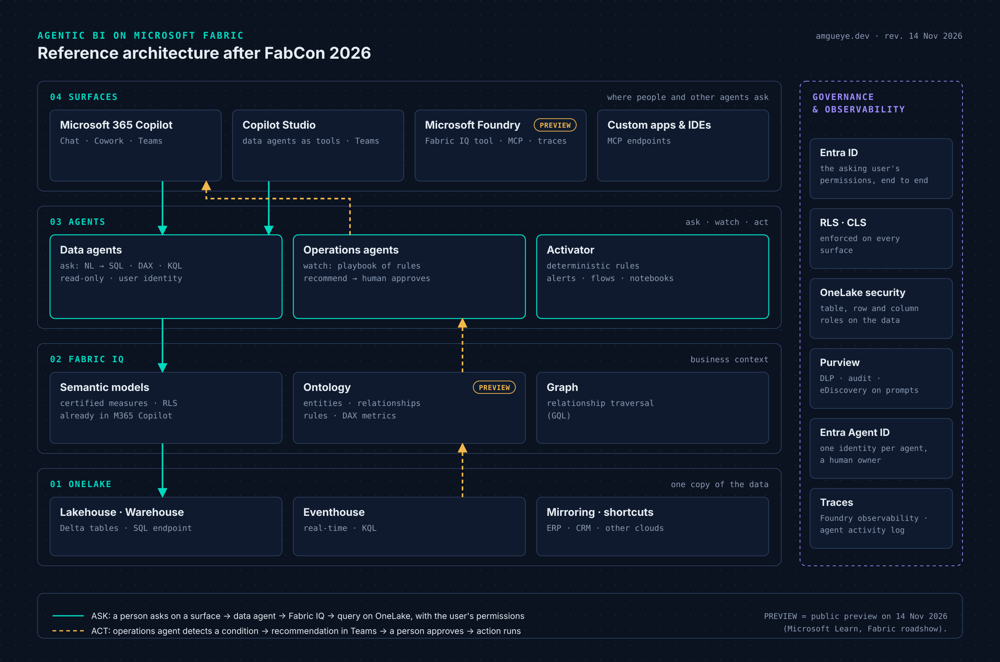

> **Updated 20 Nov 2026 with Microsoft Ignite 2026.** Microsoft IQ, Fabric IQ in Excel, ChatGPT, Claude and GitHub Copilot, Fabric apps GA and advanced query generation in data agents. See [What Ignite 2026 adds](#what-ignite-2026-adds).
{: .prompt-tip }

> **Rewritten 14 Nov 2026.** I rewrote this post after FabCon Atlanta (March), FabCon Europe in Barcelona (September) and the Microsoft Fabric roadshow I attended on 5 November. The first version predates Fabric IQ, operations agents and the MCP-based integrations, and parts of it no longer match the product. Component statuses come from Microsoft Learn and the roadshow material, as of 14 November 2026.
{: .prompt-info }

The first version of this post promised insights "with no human in the loop". That was the wrong promise. What works in production in 2026 is more useful: agents that **answer business questions where people already work**, and agents that **watch a process and propose an action that a person approves**.

The bigger change this year isn't a new agent. It is the layer underneath. One message ran through both conferences: agents fail on missing business context more often than on missing data. Fabric IQ is Microsoft's answer to that. If you design Agentic BI today, you design that context layer first.

This post gives the reference architecture I use, the status of each building block, how to choose where agents surface, and the pitfalls that show up once real users arrive.

## What changed in 2026

- **Fabric data agents are generally available**, and can now use an **ontology** as a source, alongside lakehouses, warehouses, semantic models, KQL databases and mirrored databases ([Microsoft Learn](https://learn.microsoft.com/fabric/data-science/data-agent-add-datasources)).
- **Fabric IQ** groups the business-context layer: Power BI semantic models plus the ontology (preview), on top of OneLake ([What is Fabric IQ?](https://learn.microsoft.com/fabric/iq/overview)).
- **Your semantic models are now inside Microsoft 365 Copilot.** Fabric IQ in Copilot Chat and Cowork is generally available ([Arun Ulag, 28 Sep 2026](https://azure.microsoft.com/blog/fabcon-and-sqlcon-2026-in-barcelona-building-the-data-foundation-for-microsoft-copilot-and-agents/)). Copilot finds a Power BI report the user can access, runs DAX on its semantic model and combines the result with Work IQ (mail, files, chats). Cowork can turn a report into a task. The same models are reachable read-only from any MCP client. Bringing data agents and ontologies through these same Fabric IQ tools was shown at the roadshow as "coming soon to preview".
- **Operations agents are generally available**, with investigations (from anomaly to probable cause) in preview ([Microsoft Learn](https://learn.microsoft.com/fabric/real-time-intelligence/operations-agent)).
- **Every published data agent is also an MCP server.** Copilot Studio, Microsoft Foundry and your own apps call it as a tool ([Microsoft Learn](https://learn.microsoft.com/fabric/data-science/data-agent-mcp-server)).
- **Copilot in Power BI no longer connects directly to data agents.** Microsoft retired that integration on 26 August 2026, because it was built on the retiring OpenAI Assistants API, and points to Microsoft 365 Copilot, Copilot Studio, Foundry or MCP instead ([Microsoft post on the Fabric community](https://community.fabric.microsoft.com/t5/user/viewprofilepage/user-id/1592854)).
- **Microsoft 365 Copilot is moving into Power BI.** Microsoft 365 Copilot in Power BI and Fabric is in public preview and needs a Microsoft 365 Copilot (Premium) license. It becomes on by default from 8 December 2026, and the standalone Copilot in Power BI retires in mid-January 2027 ([Message Center MC1546429](https://mc.merill.net/message/MC1546429)). Plan for Microsoft 365 Copilot as the main conversational surface for BI users.

## What Ignite 2026 adds

Ignite (17 to 20 November, San Francisco) pushed the same idea further: the context layer is now the product. The statuses below come from the [Ignite 2026 Book of News](https://news.microsoft.com/events/ignite/2026/book-of-news/).

- **Microsoft IQ is generally available, with no new SKU.** It is the umbrella for Work IQ, Fabric IQ, Foundry IQ and Web IQ, and these context capabilities are generally available across Microsoft Copilot, GitHub Copilot, Microsoft Foundry and any agent harness that speaks MCP.
- **Your semantic models reach more tools.** Querying Power BI semantic models in Microsoft Copilot is generally available. Fabric IQ in Excel (governed questions and live, Fabric-connected PivotTables), the Fabric IQ connectors for ChatGPT and Claude, and ontologies in GitHub Copilot are in preview.
- **Fabric apps and Rayfin are generally available.** Apps run next to the data, behind Entra sign-in and the governance you already have, and can embed conversational exploration of semantic models and data agents.
- **Less copying.** Salesforce Data 360 can now query supported OneLake data without copying it (generally available).
- **Better query generation in data agents.** Microsoft announced advanced NL2SQL and advanced DAX generation as generally available in November, rolling out to the standard runtime ([Fabric community blog](https://community.fabric.microsoft.com/tag/fabric%20iq)). Some Learn pages still describe the earlier preview, so check the runtime your agents use.

For architects, the consequence is direct: a semantic model is now an interface that tools you don't control will query. Arun Ulag summed up the week on stage: "The gap isn't the model, it's everything around the model" (as reported by [MSDynamicsWorld](https://msdynamicsworld.com/story/microsoft-iq-spotlight-ignite-2026)).

## The reference architecture

{: width="2400" height="1815" }
_Four layers and one cross-cutting band. The solid path is "ask", the dashed path is "act"._

Read it bottom-up: each layer only works if the one below it is in order.

### 01 OneLake: one copy of the data

Nothing agent-specific here. Agents query lakehouses, warehouses, eventhouses and mirrored databases where they already are. Two constraints matter:

- A data agent fails when a data source sits on a capacity in a **different region** from the agent's capacity ([data agent limitations](https://learn.microsoft.com/fabric/data-science/concept-data-agent#limitations)). Decide the capacity layout before you promise cross-domain agents.
- Agents read **tables**, not files. CSV or JSON dropped in a lakehouse `Files` area is invisible until it lands in a table.

### 02 Fabric IQ: business context

This is where most of the quality of an Agentic BI solution is decided.

- **Semantic models** are the starting point. If you have certified Power BI models, the measures, hierarchies, descriptions and synonyms you already maintain are the best context an agent can get. An agent over a model where "Revenue" exists in three versions will pick one, confidently.
- **The ontology (preview)** adds what a semantic model doesn't carry: entity types that span sources (a *Shipment* in the ERP and in the telemetry stream), relationships, and rules written in plain language, such as "a shipment must not leave if its temperature is above the approved threshold" ([ontology overview](https://learn.microsoft.com/fabric/iq/ontology/overview)). Power BI measures appear in the ontology as metrics on the right entities, without copying the DAX: the measure stays owned by the semantic model. A built-in ontology agent proposes entities, relationships and bindings from your data, semantic models and documents. All of this is in preview.
- The ontology isn't a query engine. A data agent uses it to understand the question, then generates SQL, KQL or DAX against the bound source, with the asking user's permissions. Other agents read the same definitions and rules through the ontology's REST, SDK and MCP endpoints (preview), so a guardrail is written once instead of in every agent's prompt.
- **Graph** covers relationship traversal when the question is about paths and dependencies rather than aggregates.

My rule of thumb: start with semantic models, and add an ontology when you need the same business entities across several sources, or when an operations agent has to reason about entities rather than raw columns.

### 03 Agents: ask, watch, act

Three components, three different jobs.

| | Data agent | Operations agent | Activator |
|---|---|---|---|
| Job | Answers questions (pull) | Watches a process and recommends (push) | Fires deterministic rules |
| Logic | LLM generates SQL, DAX or KQL | LLM builds a playbook of rules from your goals | Rules you define |
| Human role | Asks and judges the answer | Approves or rejects each recommendation | Defines the rule upfront |
| Identity | The asking user | The creator's delegated permissions, with its own Entra Agent ID | The rule owner |

Data agents are read-only. They support up to five data sources and cap chat answers at 25 rows and 25 columns ([limitations](https://learn.microsoft.com/fabric/data-science/concept-data-agent#limitations)). Over semantic models, **advanced DAX generation** changes how they work: instead of writing DAX in one pass, the agent inspects the model, checks real column values and refines the query before running it. Microsoft announced it as generally available in November 2026, alongside advanced NL2SQL for SQL sources. Note that example question-and-query pairs still aren't supported for semantic model sources, only for SQL and KQL sources.

Operations agents send a recommendation with context to Teams, and the recipient selects **Yes** or **No**. You can later make a rule autonomous. The agent then acts without asking, using the creator's permissions ([operations agent actions](https://learn.microsoft.com/fabric/real-time-intelligence/operations-agent-actions)).

Activator remains the right tool when the condition is known and fixed, for example "temperature above 8 °C for 10 minutes". Don't put an LLM where a threshold works.

### 04 Surfaces: where people and other agents ask

A published data agent can surface in four places. Pick based on who asks and what else the experience must do.

| Surface | Best for | How the data agent plugs in | Status (20 Nov 2026) |
|---|---|---|---|
| Microsoft 365 Copilot and Teams | Business users asking ad hoc questions | Semantic models through Fabric IQ; data agents published to the Agent Store, then chat or `@mention` it ([Learn](https://learn.microsoft.com/fabric/data-science/data-agent-microsoft-365-copilot)) | GA (data agents via Fabric IQ tools: coming soon to preview) |
| Copilot Studio | A business agent that mixes data answers with workflows and other tools | Add the data agent as a tool; several data agents per agent; publish to Teams or Microsoft 365 Copilot ([Learn](https://learn.microsoft.com/fabric/data-science/data-agent-microsoft-copilot-studio-tool)) | GA |
| Microsoft Foundry | Pro-code multi-agent solutions with tracing | Fabric IQ tool from the OneLake catalog, several data agents, each exposed over MCP ([Learn](https://learn.microsoft.com/fabric/data-science/data-agent-foundry-fabric-iq)). The older custom-tool integration is unsupported since 6 November 2026 | Preview |
| Excel, ChatGPT, Claude | Analysts and users who live outside Power BI | Fabric IQ in Excel; Fabric IQ connectors query semantic models from ChatGPT or Claude ([Book of News](https://news.microsoft.com/events/ignite/2026/book-of-news/)) | Preview |
| Fabric apps | Governed business apps next to the data | Embedded conversational exploration of semantic models and data agents ([Book of News](https://news.microsoft.com/events/ignite/2026/book-of-news/)) | GA (Fabric apps) |
| Custom apps and IDEs | Embedding answers in your own product or developer tools | Call the data agent's MCP endpoint with a Fabric token ([Learn](https://learn.microsoft.com/fabric/data-science/data-agent-mcp-server)); semantic models read-only through the Fabric IQ MCP server; ontology MCP server (preview) | No preview label (ontology MCP: preview) |

The same data agent can serve every one of these surfaces. Build it once, evaluate it once, and treat the surfaces as distribution channels.

Two nuances for Microsoft 365 Copilot. First, there are two routes in: publishing a data agent to the Agent Store (data agents in Copilot and Copilot Studio were presented as GA at the roadshow), and the native Fabric IQ route, which is GA for semantic models and "coming soon to preview" for data agents and ontologies. Second, the Fabric IQ route doesn't need an F SKU or Copilot in Fabric. Users need a Microsoft 365 Copilot license (or Copilot pay-as-you-go) and access to the reports. DAX generation isn't billed, but DAX execution consumes capacity units on the workspace that hosts the model.

### Context comes from more than Fabric

Since Ignite 2026, these sources sit under **Microsoft IQ**, generally available with no new SKU. Agent context comes from four sources that combine: **Fabric IQ** for business data and definitions, **Work IQ** for how people work (mail, meetings, files, chats), **Foundry IQ** for policies and documents, and **Web IQ** for public context. A question like "should we change the price of product X?" needs all four: sales and margin, customer objections from the field, the pricing approval policy, and competitor prices. Fabric IQ is the part a data architect owns, and the part that decides whether the numbers in that answer can be trusted.

### Governance and observability: the band across all layers

- **Identity end to end.** Data agents query with the requesting user's credentials, so row-level and column-level security apply on every surface ([data agent concepts](https://learn.microsoft.com/fabric/data-science/concept-data-agent)). Purview DLP and access restriction policies also constrain what the agent can return.
- **Compliance boundary.** When a data agent is consumed in Microsoft 365 Copilot, Copilot Studio, Foundry or an MCP client, its responses can leave Fabric's compliance boundary or region and follow that surface's data handling terms. Every one of those Learn pages says so. Get this signed off by your security team before the pilot, not after.
- **Agent identities.** Each operations agent gets its own Microsoft Entra Agent ID, so its actions are audited separately from human actions ([Learn](https://learn.microsoft.com/fabric/real-time-intelligence/operations-agent#operations-agent-identities)).
- **Traces.** In Foundry, the data agent's spans (which sources it queried, how long each step took) land in the project's Application Insights resource. That observability integration is in preview ([Learn](https://learn.microsoft.com/fabric/data-science/fabric-data-agent-foundry-observability)). Inside Fabric, data agent observability and user feedback (which answers go wrong) were shown in preview at the roadshow.
- **Admin and owner controls.** Fabric IQ in Copilot is on by default in the Microsoft 365 admin center, and admins decide who can use Fabric data in Copilot Chat and Cowork. Each semantic model owner can block Copilot for that model. Microsoft Purview DSPM and AI observability (both preview) show which agents touch sensitive data.

## Pitfalls I would plan for

These come from putting data agents in front of business users, including an "AI for BI" rollout for a logistics group that combined a Fabric data agent, Copilot Studio and Microsoft 365 Copilot Chat.

- **The agent is only as good as the semantic model.** Ambiguous measure names, missing descriptions and duplicate business definitions turn into confident wrong answers. Budget model clean-up as part of the agent project, not as a follow-up.
- **The orchestrator rewrites the answer.** In Microsoft 365 Copilot, an orchestrator reasons over the data agent's output before replying, and Microsoft notes that some change is inevitable even if your publishing description asks for the answer as-is ([Learn](https://learn.microsoft.com/fabric/data-science/data-agent-microsoft-365-copilot#control-how-microsoft-copilot-handles-the-output-from-fabric-data-agent)). Test numbers on the surface users will see, not only in Fabric. I covered a test harness for that in [How Accurate Is Your Fabric Data Agent?]().
- **"Agent author authentication" changes who sees what.** In Copilot Studio you choose between user authentication and agent author authentication for the connected data agent ([Learn](https://learn.microsoft.com/fabric/data-science/data-agent-microsoft-copilot-studio)). Pick user authentication for anything behind row-level security, and confirm users have access to the agent and its sources.
- **Operations agents act as their creator.** Approved actions run with the creator's permissions. Create production agents from an account whose access you would accept for the action, and keep rules in approval mode until the recommendation history earns trust.
- **Language.** Data agents don't currently support non-English languages, and Microsoft recommends English questions, instructions and example queries ([limitations](https://learn.microsoft.com/fabric/data-science/concept-data-agent#limitations)). For French-speaking teams in France or West Africa, plan for that in the pilot scope and in user training.
- **The 25-row cap.** "Show me all customers" gets truncated, and follow-up questions then reason over the truncated context.
- **Preview churn in the context layer.** The ontology is still in preview, and its old experience retires on 31 January 2027 ([Learn](https://learn.microsoft.com/fabric/iq/ontology/old-experience/concepts-agent-integration)). Keep ontology definitions in source control and expect to revisit them.
- **Answers reflect the last refresh.** Copilot answers over a semantic model are only as fresh as its last refresh. Tell users where freshness is shown, and have agents state it in their answers.

## A rollout path that holds up

1. **Ask.** One data agent on one certified semantic model, with a ground-truth test set, published to the surface your users already open, usually Teams. Measure accuracy on critical questions before you widen access.
2. **Act.** One operations agent on one process with a clear goal (stock-outs, late shipments, failed pipelines), in approval mode, with recommendations sent to the people who own the decision.
3. **Scale.** Add an ontology when several domains need the same entities. Put several data agents behind a Copilot Studio or Foundry orchestrator, and turn on tracing.

## Takeaways

- Agentic BI in 2026 means **ask** and **act with approval**, not "no human in the loop".
- Design the **context layer** first. Certified semantic models already carry what an agent needs: trusted measures, correct joins, business vocabulary and per-user security. They are now usable in Microsoft 365 Copilot as they are. Add an ontology when you need cross-source entities and rules shared by several agents.
- Build each data agent once and **distribute it over MCP** to Microsoft 365 Copilot, Copilot Studio, Foundry and your own apps.
- Treat identity, compliance boundaries and the preview status of each building block as architecture decisions, documented upfront.

## Sources

- Arun Ulag, Microsoft: [FabCon and SQLCon 2026 in Barcelona: Building the data foundation for Microsoft Copilot and agents](https://azure.microsoft.com/blog/fabcon-and-sqlcon-2026-in-barcelona-building-the-data-foundation-for-microsoft-copilot-and-agents/) (28 Sep 2026)
- Microsoft Learn: [What is Fabric IQ?](https://learn.microsoft.com/fabric/iq/overview) and [What is ontology (preview)?](https://learn.microsoft.com/fabric/iq/ontology/overview)
- Microsoft Learn: [Fabric data agent concepts](https://learn.microsoft.com/fabric/data-science/concept-data-agent) and [Add and configure data sources](https://learn.microsoft.com/fabric/data-science/data-agent-add-datasources)
- Microsoft Learn: [Create and configure operations agents](https://learn.microsoft.com/fabric/real-time-intelligence/operations-agent) and [Operations agent actions](https://learn.microsoft.com/fabric/real-time-intelligence/operations-agent-actions)
- Microsoft Learn: [Data agent as MCP server](https://learn.microsoft.com/fabric/data-science/data-agent-mcp-server), [in Microsoft 365 Copilot](https://learn.microsoft.com/fabric/data-science/data-agent-microsoft-365-copilot), [as a tool in Copilot Studio](https://learn.microsoft.com/fabric/data-science/data-agent-microsoft-copilot-studio-tool), [in Foundry with Fabric IQ](https://learn.microsoft.com/fabric/data-science/data-agent-foundry-fabric-iq)
- Microsoft Learn: [Observability for Fabric data agents in Microsoft Foundry](https://learn.microsoft.com/fabric/data-science/fabric-data-agent-foundry-observability)
- Microsoft: [Ignite 2026 Book of News](https://news.microsoft.com/events/ignite/2026/book-of-news/) (17 Nov 2026), sections Microsoft IQ, Fabric IQ and Microsoft Fabric
- Microsoft Fabric community blog: [Advanced NL2SQL and advanced DAX generation in Fabric data agents (Generally Available)](https://community.fabric.microsoft.com/tag/fabric%20iq)
- Microsoft Fabric roadshow, 5 November 2026: sessions on Fabric IQ, data agents, ontology and Real-Time Intelligence (attended in person; slides not public)
- Microsoft 365 Message Center: [MC1546429, Power BI retiring standalone Copilot experiences (preview)](https://mc.merill.net/message/MC1546429) (archived copy, 10 Nov 2026)
