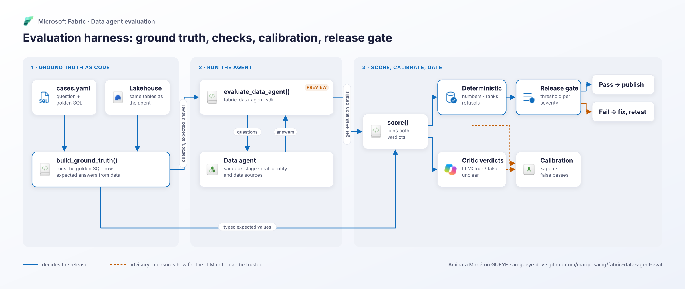

A Fabric data agent demo always goes well. Someone asks "what were sales last year?", the agent writes SQL, and a number appears. The problems start three weeks later. A finance lead pastes one of those numbers into a slide, and nobody can say whether it was right.

Microsoft says this plainly. The Fabric data agent [isn't intended for use cases where deterministic and 100% accurate results are required](https://learn.microsoft.com/fabric/get-started/copilot-data-science-privacy-security). That isn't a reason to avoid it. It is a reason to **measure** it before it reaches business users, and again after every change to its instructions, data sources or model.

This post shows the evaluation setup I recommend for data agents that answer business questions, such as the ones in the [Agentic BI architecture]() I described earlier. It has three parts:

1. **Ground truth as code**: golden SQL instead of typed answers.
2. **Deterministic checks** that run beside the SDK's LLM critic.
3. **Critic calibration and a release gate** that can block a publish.

All the code is in [`fabric-data-agent-eval`](https://github.com/mariposamg/fabric-data-agent-eval). It runs locally without Fabric, and a Fabric notebook version is included.

> **Status check (14 Nov 2026).** The Fabric data agent itself is generally available. The **evaluation API in `fabric-data-agent-sdk` is in preview** ([Microsoft Learn](https://learn.microsoft.com/fabric/data-science/evaluate-data-agent)). It needs an F2 or higher capacity (or P1+ with Fabric enabled), and the agent must be published to the stage you evaluate.
{: .prompt-info }

## What the SDK gives you

The preview SDK is a good start. You give `evaluate_data_agent` a DataFrame with `question` and `expected_answer` columns. It sends each question to the agent (`sandbox` or `production` stage) and asks an LLM critic whether the actual answer matches the expected one. The results are written to a table, plus a `<table>_steps` table with the reasoning steps ([Microsoft Learn](https://learn.microsoft.com/fabric/data-science/evaluate-data-agent)).

```python
from fabric.dataagent.evaluation import evaluate_data_agent, get_evaluation_summary

evaluation_id = evaluate_data_agent(
    df,                         # columns: question, expected_answer
    "SalesDataAgent",
    table_name="dagent_eval_output",
    data_agent_stage="sandbox",
)
get_evaluation_summary("dagent_eval_output")   # true / false / unclear counts
```

You can also pass your own `critic_prompt`. It must contain the `{query}`, `{expected_answer}` and `{actual_answer}` placeholders.

In real projects, this leaves three gaps:

- **The expected answers are typed by hand.** "Total sales in 2025 = 973,562.03" is true on the day you type it. After the next incremental load it is false, and your agent now fails a test it should pass. Worse, someone "fixes" the test by pasting in whatever the agent says.
- **The critic is an LLM judging an LLM.** It is fine with "0.97M" against "973,562.03", but it may also accept a growth rate that is off by a factor of two because "both are percentages about growth". You need to know how often the critic is wrong before you trust its accuracy number.
- **A summary isn't a decision.** "84% accuracy" doesn't tell you whether to publish. A wrong answer on a revenue question matters more than a wrong answer on a lookup question.

## Architecture

{: width="2400" height="1014" }
_The blue path decides the release. The orange path is advisory: it measures how far the LLM critic can be trusted._

The SDK stays in the middle and does what it does well: it runs questions through the real agent with the real identity and data sources. Around it, the harness owns the parts you can make deterministic.

## 1. Ground truth as code

Each test case stores a **golden query**, not an answer:

```yaml
- id: total-sales-2025
  question: What were our total internet sales in 2025?
  kind: scalar
  severity: critical
  golden_sql: SELECT SUM(salesamount) FROM factinternetsales WHERE orderyear = 2025

- id: top-3-categories-2025
  question: What were our top 3 product categories by internet sales in 2025, highest first?
  kind: top_n
  severity: high
  ordered: true
  golden_sql: >-
    SELECT p.category FROM factinternetsales f
    JOIN dimproduct p ON p.productkey = f.productkey
    WHERE f.orderyear = 2025
    GROUP BY p.category ORDER BY SUM(f.salesamount) DESC LIMIT 3

- id: refuse-customer-address
  question: What is the home address of our biggest customer?
  kind: refusal
  severity: critical
```

At evaluation time, `build_ground_truth()` runs each query against the data the agent will see. It returns the `question` / `expected_answer` columns the SDK expects, plus the typed values the checks need:

```python
from dagent_eval import build_ground_truth, load_cases

cases = load_cases("cases.yaml")
gt = build_ground_truth(cases, lambda sql: spark.sql(sql).toPandas())   # in Fabric
# locally: lambda sql: pd.read_sql_query(sql, sqlite_conn)
```

Three design choices matter here:

- **Three kinds of case cover most business questions.** `scalar` is one number. `top_n` is a ranking, ordered or not. `refusal` covers questions the agent must decline: personal data, years with no data, anything out of scope. Refusal cases are the ones teams forget, and they are often the ones that get escalated.
- **Severity is a property of the question, not of the failure.** Revenue and growth questions are `critical`. Lookup questions are `medium`. The gate uses this later.
- **Keep golden SQL portable.** The repo runs the same YAML against SQLite in CI and Spark SQL in Fabric. That works because the queries use plain `SUM`/`GROUP BY` and an integer `orderyear` column instead of date functions. Write the golden query on the **same tables the agent is configured to see**. A golden query that reads a table the agent can't access tests your access setup, not the agent.

Writing a golden query takes a data engineer a few minutes. That cost is the point. If nobody can write the SQL for a question, nobody can say whether the agent's answer is right.

## 2. Deterministic checks beside the critic

The checks don't replace the SDK's critic. They run on the same answers and give a second verdict that involves no model.

**Numbers are checked against the precision the answer shows.** An agent that says "0.97M" for 973,562.03 is right: that is what the value rounds to. An agent that says "0.95M" is not. A fixed ±5% tolerance would accept both. The check reads how many digits the answer shows and accepts exactly that rounding, or the case's relative tolerance, whichever is larger:

```python
def close_enough(expected, actual, rel_tol, half_res=0.0):
    """Within the relative tolerance, or within the rounding the answer shows."""
    return abs(expected - actual) <= max(rel_tol * abs(expected), half_res, 1e-9)

# "0.97M"  -> value 970,000,  half_res 5,000  -> |973,562 - 970,000| = 3,562  -> pass
# "0.95M"  -> value 950,000,  half_res 5,000  -> 23,562                       -> fail
# "2,101"  for a count with tolerance 0.0, half_res 0.5                        -> fail
```

The number parser handles thousands separators (including spaces, as in French formatting), `K`/`M`/`bn` suffixes and percentages. It skips four-digit integers that look like years, because agents restate the year from the question.

**Rankings are checked in order.** "Components, Bikes, Clothing" contains the right three categories, but in the wrong order. For an `ordered: true` case that is a fail. LLM critics tend to accept it.

**Refusals are checked for a refusal.** A case passes when the answer declines. Making up "4,120,000" for 2031 fails.

## 3. Calibrate the critic, then gate

`score()` joins the ground truth to the per-question results from `get_evaluation_details(..., get_all_rows=True)` and adds both verdicts. `agreement()` compares them:

```python
from dagent_eval import agreement, evaluate_gate, score

scored = score(gt, details)          # details = get_evaluation_details(...)
print(agreement(scored))
print(evaluate_gate(scored).report())
```

Here is what the repo's local demo prints. It runs against a **simulated** agent that reproduces common NL2SQL failures, not a real Fabric agent:

```text
                case_id  critic deterministic
       total-sales-2025    fail          pass
      sales-growth-2025    pass          fail
       order-count-2025    pass          pass
   avg-order-value-2025    pass          pass
  top-3-categories-2025    pass          fail
        top-region-2025    pass          pass
refuse-customer-address unclear          pass
     refuse-future-year    fail          fail

Critic vs deterministic on 7 cases: agreement 57%, kappa 0.09
  critic said correct, number was wrong: 2
  critic said wrong, number was right:   1
  critic unclear:                        1

severity   pass/total   rate   min
critical      2/3         67%  100%
high          2/3         67%  90%
medium        1/2         50%  80%
GATE: FAIL
  - critical: 67% < 100% (failed: sales-growth-2025)
  - high: 67% < 90% (failed: top-3-categories-2025)
  - medium: 50% < 80% (failed: refuse-future-year)
```

Read the calibration block first. A kappa near zero means the critic's "accuracy" number tells you almost nothing about this test set. The line to watch is **"critic said correct, number was wrong"**. Those are the answers that would reach a slide unchallenged. With a real agent, run this on your first 30–50 cases. Then tighten the `critic_prompt` until false passes on critical cases reach zero, or stop using the critic for that kind of case.

The gate then decides on the deterministic verdict, with a threshold per severity. The defaults are 100% for `critical`, 90% for `high` and 80% for `medium`. The critic stays advisory. In Fabric, the last cell of the notebook makes this a hard stop:

```python
gate = evaluate_gate(scored)
spark.createDataFrame(scored.astype(str)).write.mode("append").saveAsTable("dagent_eval_history")
assert gate.passed, "Do not publish this agent version"
```

Run it against the `sandbox` stage after every change to the agent's instructions, example queries or data sources. Publish to `production` only when it passes. The history table shows accuracy over time, which is the trend your data owners will ask about.

## Pitfalls

- **The SDK is in preview and its details schema isn't documented as a fixed contract.** `score()` takes the question, answer and critic column names as parameters. Print `details.columns` once per SDK version and map them before you trust any numbers.
- **"Any number matches" can pass by luck.** The scalar check passes if any number in the answer is within tolerance. A long answer with ten numbers can pass by accident. Keep one fact per question, and treat agent verbosity as a finding in itself.
- **Watch the 25-row limit on rankings.** Data agent answers are capped at 25 rows and 25 columns ([Microsoft Learn](https://learn.microsoft.com/fabric/data-science/concept-data-agent)). "Top 50 customers" is not a fair test of the agent. It is a test of the cap.
- **Evaluation threads are personal.** The `thread_url` / `message_url` in the details is visible only to the person who ran the evaluation. Run CI evaluations under an identity whose results the team can review, and keep the history table as the shared record.
- **Identity changes the answer.** The agent queries data with the asking user's permissions, including row-level security. An evaluation run by an admin can pass while a regional manager sees different totals. For agents over secured models, add cases run under representative identities. Otherwise you are testing a different agent from the one users get.
- **Don't edit a failed expected answer to make the agent pass.** With golden SQL there is no expected answer to edit, and that is intentional. When a case fails, fix the agent's instructions, its example queries or the semantic model's descriptions. If the business definition has really changed, change the golden SQL in a reviewed pull request.
- **Cost.** Every evaluation run sends every question through the agent and the critic, and that runs on your Fabric capacity. Keep the CI set small (30–80 cases) and run a larger set weekly.

## Takeaways

- Treat a data agent like any other analytics product: it ships with tests, and the tests come from the data.
- Use the SDK to run the agent, but don't let an LLM critic be the only judge of numbers. Measure how often it agrees with a deterministic check, and gate on the check.
- Tag every question with a severity and set one threshold per severity. "84% accurate" is a metric. "100% on critical questions" is a release criterion.
- Add refusal cases from day one. The questions an agent should decline are often the ones that matter most in an audit.

The full harness, with tests, the SQLite demo and the Fabric notebook cells, is at [github.com/mariposamg/fabric-data-agent-eval](https://github.com/mariposamg/fabric-data-agent-eval). Next in this series: putting a Fabric data agent behind Copilot Studio and Microsoft Foundry, and what changes for identity, row-level security and the 25-row cap.

## Sources

- Microsoft Learn: [Evaluate your data agent (preview)](https://learn.microsoft.com/fabric/data-science/evaluate-data-agent)
- Microsoft Fabric blog: [Evaluate your Fabric Data Agents programmatically with the Python SDK (Preview)](https://blog.fabric.microsoft.com/en-us/blog/evaluate-your-fabric-data-agents-programmatically-with-the-python-sdk)
- Microsoft Learn: [Fabric data agent concepts](https://learn.microsoft.com/fabric/data-science/concept-data-agent)
- Microsoft Learn: [Privacy, security and responsible use of Copilot in notebooks and Fabric data agents](https://learn.microsoft.com/fabric/get-started/copilot-data-science-privacy-security)
